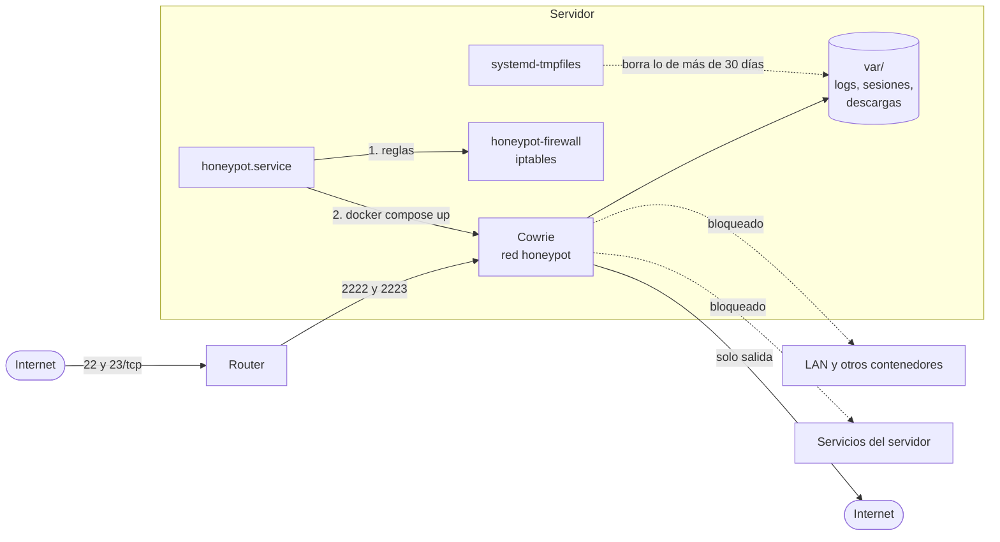

# cowrie-honeypot

Honeypot SSH y Telnet con [Cowrie](https://github.com/cowrie/cowrie) en Docker, corriendo en mi servidor casero. Lo monté para ver qué pasa de verdad cuando expones un puerto 22 a internet: quién entra, qué contraseñas prueba, qué comandos lanza y qué intenta descargar.

El shell es falso: acepta casi cualquier contraseña, graba la sesión y guarda los ficheros que suben, pero no ejecuta nada. La parte importante es que, aunque Cowrie tuviera un fallo, el contenedor no pueda tocar nada de mi red.

## Arquitectura



El SSH real del servidor sigue en su puerto, cerrado a internet. El router manda el 22 y el 23 de fuera a los puertos del honeypot.

## Aislamiento

Lo he planteado por capas, asumiendo que el contenedor puede acabar comprometido:

**Contenedor** (`docker-compose.yml`)
- Usuario 999, sin root.
- Rootfs de solo lectura: solo puede escribir en `./var` y en un `/tmp` de 16 MB.
- `cap_drop: ALL` y `no-new-privileges`.
- Límites de 256 MB de RAM, media CPU y 64 procesos, para que no tumbe el servidor.
- `COWRIE_SSH_FORWARDING=false`: si no, lo pueden usar de proxy para atacar a terceros desde mi IP.

**Red** (`honeypot-firewall`)
- La red Docker del honeypot tiene una subred fija para poder filtrar por ella.
- En la cadena `DOCKER-USER` se corta el tráfico hacia todos los rangos privados (LAN, otras redes Docker, link-local, CGNAT). Esta cadena es la que Docker respeta; las reglas de ufw no se aplican a los puertos que publica Docker.
- En `INPUT` se corta todo lo que va del contenedor al propio servidor, salvo DNS.
- Las respuestas a conexiones ya establecidas sí salen; si no, el honeypot no podría contestar a nadie.

**systemd** (`honeypot.service`)
- Las reglas de iptables no sobreviven a un reinicio, así que el servicio las aplica en `ExecStartPre`, antes de `docker compose up`. Si el cortafuegos falla, el contenedor no arranca.

**Limpieza** (`honeypot.tmpfiles`)
- Logs, sesiones grabadas y descargas de más de 30 días se borran solos.

## Instalación

Requisitos: Linux con systemd, iptables, Docker y Docker Compose v2.

```bash
git clone https://github.com/IsDerky/cowrie-honeypot.git
cd cowrie-honeypot
cp .env.example .env    # ajusta PRUEBA_DESTINOS a tu red
sudo bash install.sh
```

`install.sh` es idempotente:
1. Comprueba que la subred está libre.
2. Copia los ficheros a `/opt/honeypot`, el cortafuegos a `/usr/local/bin` y la unidad a systemd.
3. Arranca el servicio (cortafuegos primero).
4. Pasa la prueba de aislamiento y, si falla, para el honeypot.

Después, en el router: `22 → servidor:2222` y `23 → servidor:2223` (TCP).

## Probar el aislamiento

```bash
sudo /opt/honeypot/prueba-aislamiento.sh
```

Levanta un contenedor Alpine temporal en la misma red que Cowrie e intenta conectar con cada destino de `PRUEBA_DESTINOS`: router, servicios del servidor, el PC… Ninguno debe responder. También comprueba que hay salida a internet, que es lo único permitido.

```
  ✓ sin acceso a 192.168.1.1:80
  ✓ sin acceso a 192.168.1.10:22
  ✓ sin acceso a 192.168.1.10:3306
  ✓ sin acceso a 172.30.250.1:22
  ✓ sin acceso a 172.17.0.1:80
  ✓ sale a internet
```

Si algún destino responde, el script sale con error.

## Lo que se ve

Un día cualquiera (24 h hasta el 5 de noviembre de 2026):

- Unos **5.400 intentos por SSH y 1.700 por Telnet**, desde **295 IPs** distintas.
- El usuario más probado es `root`, con diferencia. En Telnet, `admin`.
- Las credenciales más repetidas son `admin`/`admin`, `support`/`support` y `root`/`123456`.
- Casi el 60 % del tráfico viene de una sola red de Rumanía que entra cada pocos minutos, lanza `uname -s -v -n -r -m` y se va. No ataca: va catalogando máquinas.
- Por Telnet llegan sobre todo bots tipo Mirai, que prueban `/bin/busybox` y buscan routers y cámaras.
- Cada día suben algún binario. Se queda guardado con su sha256 para mirarlo en VirusTotal.

## Lecciones aprendidas

- **Docker se salta ufw.** Los puertos publicados por Docker no pasan por las reglas de ufw. Para filtrar el tráfico de un contenedor hay que usar `DOCKER-USER`.
- **El orden de arranque importa.** Las reglas de iptables se pierden al reiniciar. Atar el cortafuegos al `ExecStartPre` del servicio evita que el honeypot arranque, aunque sea un momento, sin aislar.
- **Probar el aislamiento, no suponerlo.** Escribir las reglas no basta: la prueba desde dentro de la red del contenedor es lo que me da tranquilidad, y por eso la instalación falla si no pasa.
- **La mayoría del "ataque" es ruido automatizado.** Escáneres y bots que repiten lo mismo. Agrupar por red (ASN) dice mucho más que mirar IPs sueltas.
- **El honeypot no es donde atacan de verdad.** Los intentos serios contra mi servidor iban a otros servicios expuestos (el SFTP de un panel de juegos). Eso me llevó a ponerles fail2ban con reglas propias.

## Ficheros

| Fichero | Qué hace |
|---|---|
| `docker-compose.yml` | Cowrie con los límites de arriba |
| `honeypot-firewall` | Reglas de iptables del aislamiento |
| `honeypot.service` | Unidad systemd: cortafuegos y luego `docker compose up` |
| `honeypot.tmpfiles` | Borrado de lo que tenga más de 30 días |
| `install.sh` | Instalación y prueba de aislamiento |
| `prueba-aislamiento.sh` | La prueba, para lanzarla cuando quieras |
| `.env.example` | Subred, puertos, hostname y destinos de la prueba |

## En mi servidor

En mi homelab, un recolector lee `cowrie.json` y lo junta con fail2ban y los logs de nginx en un panel con mapa, feed en directo y estadísticas. Lo cuento en [homelab](https://github.com/IsDerky/homelab).
